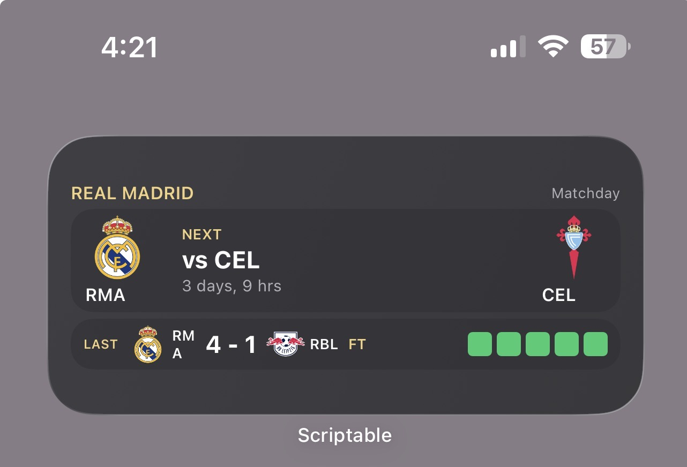

# Club Hub

A dark-themed, medium-size [Scriptable](https://scriptable.app) home-screen widget for Real Madrid fans. Two rows give you the next fixture with a live relative countdown on top, and the last result plus the club's recent form below.

Built with plain JavaScript (ES6+) for iOS/iPadOS/macOS via Scriptable. No build step, package manager, or dependencies.



*The medium widget running in Scriptable on iOS. Final appearance depends on the device and iOS 26 Home Screen appearance settings.*

## Features

- **Next match row** — both 40×40 crests, opponent code (`vs`/`at`), and an auto-updating `WidgetDate` relative countdown like "2 days, 6 hours".
- **Last match row** — compact 24pt crests with team codes, the latest score and status (`67'`, `HT`, `FT`), plus five W/D/L form blocks in green/gray/red.
- **Dynamic home/away** — Real Madrid is placed on whichever side the API reports for both rows.
- **Glass-style theme** — translucent `#1a1a1a` base, soft diagonal gradient, rounded panels and `#f1d382` gold accents. On iOS 26 the system supplies its own Liquid Glass in clear/tinted Home Screen modes; Scriptable cannot invoke that effect directly, so this is an approximation designed to stay legible over any wallpaper.
- **Resilient** — fresh API data → cached match/next fixture → bundled sample data → clean "No fixture scheduled" state. Never a blank widget.
- **Offline-friendly caching** — match JSON and crest images are cached with `FileManager`; `refreshAfterDate` respects API rate limits and refreshes just after the next kickoff when it is sooner.

## Requirements

- Scriptable app on iOS, iPadOS, or Apple Silicon macOS.
- A free API token from [football-data.org](https://www.football-data.org/client/register).
- Node.js 18+ for the optional local test tool (no packages to install).

## Setup

1. Register for a free football-data.org token.
2. Copy `index.js` into your iCloud Drive/Scriptable folder, or paste it into a new script in the Scriptable app.
3. Run the script in the Scriptable app. When prompted, enter your API token — it is stored in the Scriptable **Keychain**, never in the file.
4. Add a Scriptable widget to your Home Screen, set its size to **Medium**, and select this script.

Running the script in the app automatically shows a medium widget preview (`presentMedium()`). Tap the widget parameter field only if you want to distinguish multiple widget instances; V1 ignores it.

> **Free-tier note:** football-data.org's free plan delivers delayed scores and usually no live minute. With a free token the widget typically shows the latest finished match (or a generic `LIVE` marker). A live-scores plan is needed for minute-by-minute updates. The free tier is limited to 10 calls/minute; this widget makes three requests per 30-minute refresh (finished, live, scheduled), well within that limit.

> **iOS 26 appearance:** choose a clear or tinted Home Screen look to let the system apply Liquid Glass around the widget. The widget itself uses translucent fills and a gradient so content remains readable in both light and dark appearances; accessibility settings that reduce transparency may change the look.

## Local testing

A zero-dependency Node harness runs the real `index.js` in a simulated Scriptable runtime, checks widget invariants, and writes an HTML approximation of the widget.

```sh
export FOOTBALL_DATA_TOKEN=...        # football-data.org token; never logged
node tools/widget-lab.js              # live data + 20 assertions + preview
node tools/widget-lab.js --json       # also print the rendered model
node tools/widget-lab.js --no-key     # missing-token fallback (no token needed)
node tools/widget-lab.js --api-error  # API failure fallback
node tools/widget-lab.js --crest-fail # initials-badge fallback
node tools/widget-lab.js --help
```

To open the generated preview in your browser automatically:

```sh
./tools/view-widget.sh                # live data
./tools/view-widget.sh --no-key       # fallback state
./tools/view-widget.sh --no-open      # generate only
```

The preview is written to `.cache/widget-preview.html` (gitignored). It is an approximation for layout sanity checks only — final visual approval must be done with the real widget in Scriptable on macOS/iOS.

## Repository layout

```
docs/product_requirements_document_prd.md   Product requirements
index.js                                    The Scriptable widget (deploy this)
tools/widget-lab.js                         Local simulator + assertions + HTML preview
tools/view-widget.sh                        Generate preview and open it in a browser
AGENTS.md                                   Conventions for AI agents working here
tasks/                                      Implementation plans / decision records
.opencode/skills/scriptable/                Complete Scriptable API reference skill
```

## Deployment

Copy `index.js` to your iCloud Drive Scriptable folder or paste it into Scriptable on iOS. There is nothing to compile. The token lives in the app's Keychain on each device.

## Out of scope for V1

Small/large/Lock Screen widget variants, RSS feeds, tap-to-open highlights, and custom opponent selection. See the PRD and plans in `tasks/` for details.
